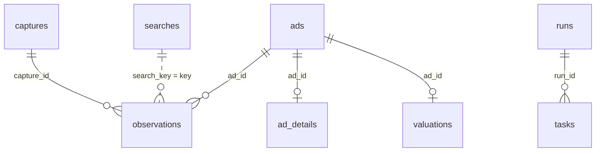

# Data model

One SQLite file, `CARWATCH_DB_PATH` (see [configuration](configuration.md)). The schema is `_SCHEMA` in
`service/src/carwatch/store.py`, created with `CREATE TABLE IF NOT EXISTS` every time a `Store` opens, in WAL mode,
with `PRAGMA user_version` set to `SCHEMA_VERSION` (3). `_upgrade` adds what an older database lacks. Times are
ISO 8601 text in UTC; prices are whole numbers in the ad's currency (the UI assumes euros when none is given).

| Table | One row per | Written by | Notes |
|---|---|---|---|
| `captures` | page the extension sent | `Store.ingest` | `payload` is the whole capture as JSON; emptied to `{}` after `capture_retention_days` when a run finishes. |
| `ads` | ad, keyed by the site's ad id | `Store.ingest` | Car fields, current `price` and `status`, `first_price`, `min_price`, `max_price`, `first_seen`, `last_seen`, `has_details`. Descriptive fields keep the newest non-null value; price and status change only from the newest sighting, so a late capture from the outbox cannot overwrite a fresher one. `status` becomes `removed` when a detail page reports the ad gone. |
| `observations` | sighting of an ad with its price and status | `Store.ingest` | `source` is `search` or `ad`; `search_key` is set for searches you opened yourself. A reload with the same price and status within 10 minutes is not a new sighting. |
| `ad_details` | ad with details | `Store.ingest` | The `AdDetail` from the ad page as JSON; a newer capture replaces an older one. |
| `searches` | search you opened yourself, keyed by its filters without the page | `Store.ingest` | Listed on `/searches`; the worker's price bands are not stored here. |
| `runs` | collection run | `Crawler` | `kind` is `full` or `search`; `status` is `running`, `done` or `cancelled`; `auto` is 1 when the host started it on its own. |
| `tasks` | page to fetch | `Crawler` | `kind` is `search` (with `query` and `page`) or `detail` (with `ad_id` and the planning `day`); `status` is `pending`, `leased`, `done` or `failed`; `attempts`, `note`. |
| `crawl_state` | key and value | `Crawler`, `analysis` | `paused_until`, `auto` (`1` or `0`), `valuation` (JSON: ads, median error, computed at, note). |
| `valuations` | ad in the last valuation | `analysis.run_valuation` | `expected_price` and `deal_pct` (how far below the expected price the ad is listed); replaced as a whole on each run. |

A lock file named after the database with `.valuation.lock` appended sits next to it while a valuation runs.
